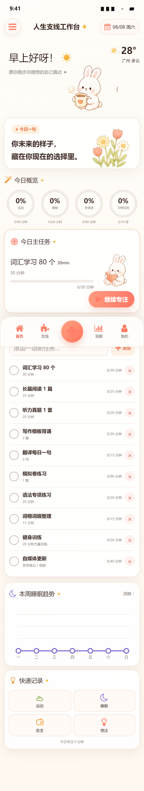
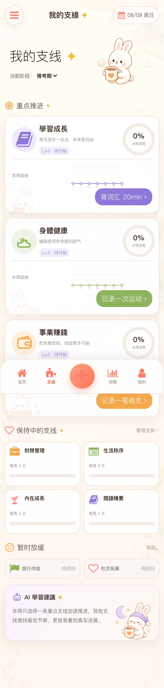
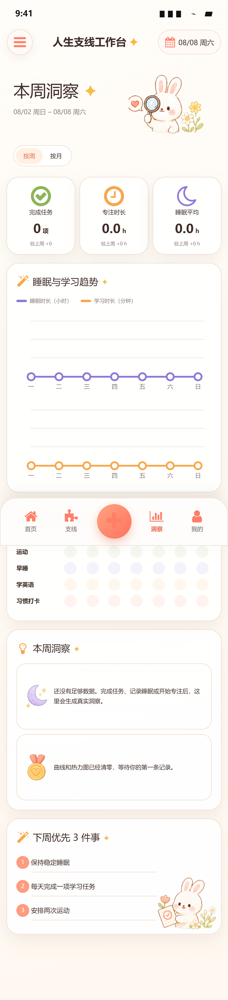
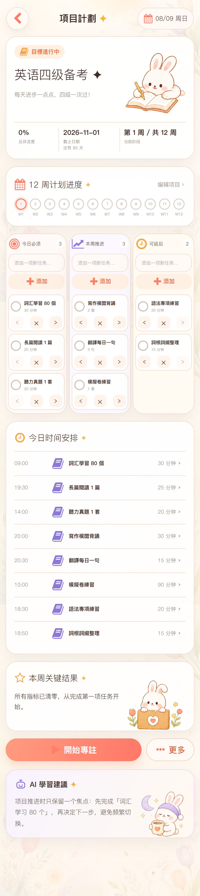
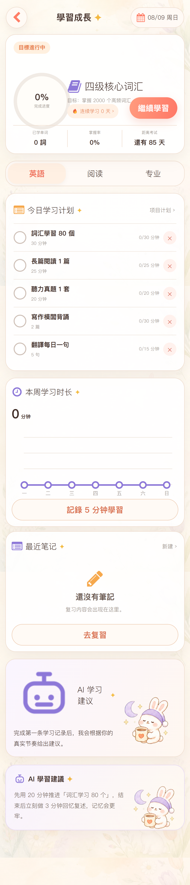

# 人生支线工作台

一套温柔、治愈、可以真正使用的移动端人生管理工具。它把学习、健康、事业、生活秩序等目标拆成一条条“人生支线”，帮助你记录行动、完成任务、专注成长，并通过零起步的数据看见真实变化。

<p align="center">
  <a href="https://life-branch-workbench.bankeliulian.chatgpt.site"><strong>在线体验</strong></a>
  ·
  <a href="./html-export/index.html"><strong>独立 HTML 版</strong></a>
  ·
  <a href="./docs/page-inventory.md"><strong>页面清单</strong></a>
</p>

> 在线站点目前采用私有访问，可能需要登录对应的 ChatGPT 账号。

## 界面预览

<p align="center">
  
  
  
</p>

<p align="center">
  
  
  
</p>

## 核心功能

- **人生支线**：管理学习成长、身体健康、事业赚钱及其他长期方向。
- **项目计划**：使用“今日必须 / 本周推进 / 可延后”三列任务板拆解目标。
- **任务系统**：支持新建、编辑、删除、完成、撤销及拖放调整分组。
- **快速记录**：随手记录运动、睡眠、收支和灵感，保存后全局同步。
- **专注计时**：开始、暂停、继续和结束专注，刷新页面后仍能恢复。
- **学习成长**：管理学习目标、每日计划、复习列表和学习笔记。
- **数据洞察**：根据真实记录生成任务、专注、睡眠、趋势与习惯热力图。
- **每日 / 每周复盘**：自动汇总数据，也可以手动补充总结和下一步计划。
- **个性化设置**：主题、角色、氛围、首页布局、提醒和隐私模块均可调整。
- **数据备份**：支持 JSON 导出、恢复备份和全部数据清零。

所有进度、实际时长、记录、曲线和热力图默认从 **0** 开始；页面中预设的是待完成目标，不会伪造用户成绩。

## 页面与路由

| 页面 | 路由 | 主要内容 |
| --- | --- | --- |
| 今日首页 | `/` | 今日概览、主任务、支持任务、趋势、快速记录 |
| 我的支线 | `/branches` | 支线分组、进度、下一步行动 |
| 支线详情 | `/branches/[id]` | 支线状态和任务管理 |
| 项目计划 | `/projects/[id]` | 12 周计划、三列任务板、时间安排 |
| 学习成长 | `/learning` | 学习目标、计划、趋势、笔记和建议 |
| 学习复习 | `/learning/review` | 复习列表与掌握状态 |
| 学习笔记 | `/learning/notes/[id]` | 笔记编辑、保存和删除 |
| 本周洞察 | `/insights` | 统计、趋势、热力图和优先事项 |
| 我的 | `/profile` | 用户资料、备份、重置和设置入口 |
| 主题外观 | `/customize` | 主题、角色、氛围和贴纸 |
| 首页布局 | `/layout-editor` | 模块排序、隐藏、固定和快捷入口 |
| 设置 | `/settings` | 设置中心 |
| 数据与隐私 | `/settings/privacy` | 模块隐私开关 |
| 提醒与专注 | `/settings/reminders` | 提醒时间、语气和动画设置 |
| 每日复盘 | `/reviews/daily` | 当日总结与下一步行动 |
| 每周复盘 | `/reviews/weekly` | 周度总结与下周计划 |

更完整的页面与设计图映射见 [docs/page-inventory.md](./docs/page-inventory.md)。

## 技术栈

- React 19
- Next.js 16 App Router
- vinext + Vite 8
- TypeScript
- CSS 响应式移动端布局
- Playwright 端到端与视觉测试
- localStorage 本地持久化
- OpenAI Sites / Cloudflare 兼容构建

项目以 375–430px 手机屏幕为主要设计目标，在桌面端会居中显示为移动应用工作台。

## 本地运行

### 环境要求

- Node.js `>= 22.13.0`
- npm

### 启动项目

```bash
git clone https://github.com/bankeluilian/life-workbench-web.git
cd life-workbench-web
npm install
npm run dev
```

根据终端输出打开本地地址即可。

### 正式构建

```bash
npm run build
npm run start
```

## 独立 HTML 版本

不安装 Node.js 也可以使用静态 HTML 版：

1. 下载或克隆本仓库。
2. 打开 [`html-export/index.html`](./html-export/index.html)。
3. 保持 `index.html` 与同目录的 `assets` 文件夹一起移动。

HTML 版包含首页、支线、洞察、个人中心、快速记录、任务打卡、专注计时、数据导出和清零功能，数据同样保存在浏览器本地。

## 数据说明

- React 版存储键：`life-workbench-state-v3`
- HTML 版存储键：`life-workbench-html-v1`
- 数据仅保存在当前浏览器设备中，不会默认上传到服务器。
- 清除浏览器站点数据会删除本地记录，重要内容请先导出 JSON 备份。

## 测试

```bash
# ESLint
npm run lint

# 构建、HTML 检查与 Playwright 测试
npm test

# 端到端交互测试
npm run test:e2e

# 视觉截图测试
npm run test:visual
```

当前测试覆盖：

- 一级与二级路由访问
- 任务完成状态与持久化
- 运动、睡眠记录及洞察联动
- 专注计时暂停与刷新恢复
- 390px、430px 多页面视觉截图

## 项目结构

```text
app/                    React / Next.js 页面与应用代码
app/workbench/          状态、组件、页面和全局弹层
public/assets/clean/    水彩插画与 UI 素材
html-export/            可独立打开的 HTML 版本
tests/                  Playwright 交互与视觉测试
tests/screenshots/      多页面验收截图
docs/                   页面、交互、设计与实施说明
docs/xiaohongshu/       小红书发布与表现资料
```

## 设计与实现原则

- 所有统计来自用户的真实操作，不使用虚构完成数据。
- 插画只承担氛围和角色表达，交互组件使用真实 HTML、CSS 与 React 实现。
- 任务、项目、支线、学习和洞察读取同一份全局状态。
- 优先保证触摸操作、键盘可用性、移动端安全区和无横向溢出。

更多资料：

- [交互映射](./docs/interaction-map.md)
- [设计系统](./docs/design-system.md)
- [实施状态](./docs/implementation-status.md)
- [小红书发布资料](./docs/xiaohongshu/README.md)
